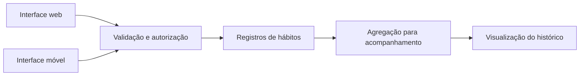

# Arquitetura de referência

Diagrama conceitual; não representa um ambiente implantado.

## Decisões a avaliar

Um registro informado pelo usuário e uma interpretação automática têm origens diferentes. Armazenar a origem e permitir correção evita que uma inferência adquira aparência de informação confirmada.

Interfaces web e móvel ampliam a disponibilidade de entrada, mas também introduzem conflitos de atualização. A discussão deve incluir a identidade de cada registro e como informar que uma alteração não foi salva, sem silenciosamente substituir um dado mais recente.

Consentimento e controle de acesso devem ser tratados na camada que entrega os dados, não apenas escondendo elementos na tela.

## Roteiro de validação

- Enviar um registro incompleto e conferir a resposta de validação.
- Repetir a mesma ação e verificar a política de duplicação.
- Simular atualizações concorrentes sobre um registro fictício.
- Tentar acessar registros de outra conta.
- Verificar a remoção de dados derivados após uma solicitação de exclusão.
- Conferir que relatórios de erro não incluem dados pessoais.

Os itens são critérios sugeridos, não resultados de testes executados. O case não demonstra segurança clínica nem prontidão de um produto de saúde.
